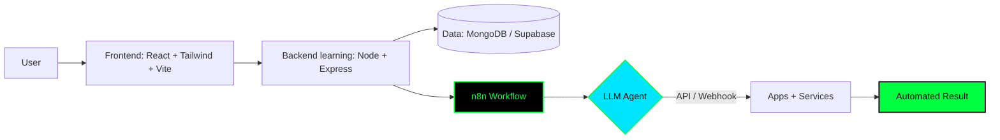

<div align="center">


<br/>

<a href="https://portfolio-v2-chi-lilac.vercel.app/"></a>


<br/>
<sub>19 · Guelma / Bejaia, Algeria · Higher School of Computer Science (ESI Bejaia)</sub>
<br/>


</div>

---

## Contents

- [Profile](#profile)
- [Focus areas](#focus-areas)
- [CTF toolkit](#ctf-toolkit)
- [Tech stack](#tech-stack)
- [How I work](#how-i-work)
- [Selected repositories](#selected-repositories)
- [Activity](#activity)
- [Roadmap](#roadmap)
- [Connect](#connect)

---

## Profile

```bash
$ whoami
israa chiheb — @itsmeisraa
frontend developer + CTF player, learning backend and AI automation
```

I build frontend interfaces and I am working toward full-stack. In parallel I practice cybersecurity through CTFs (web, forensics/OSINT, reverse) and I build AI automations with n8n that connect apps, APIs and LLMs into working workflows.

Beyond code: swimming, gaming, sports photography.

| Now | Learning | Interests |
|---|---|---|
| Frontend interfaces (HTML, CSS, JS, Tailwind, React) | Node.js & Express backend | Web exploitation, reverse, forensics |
| CTF practice (TryHackMe, Hack The Box, PicoCTF) | n8n AI automations, LLM agents, webhooks | Kali Linux labs |
| Portfolio v2 — live | Deeper cybersecurity | Sports photography |

Portfolio: <https://portfolio-v2-chi-lilac.vercel.app/>

---

## Focus areas

### 1. Frontend development — implemented
Building responsive interfaces with HTML, CSS, JavaScript, Tailwind and React (Vite). Evidence: live portfolio plus practice repos such as `my-counter-app` and `ColorPicker`.

### 2. CTF & security — practicing
- Web: SQLi, XSS, IDOR and related fundamentals
- Forensics & OSINT: finding what is hidden
- Reverse engineering: understanding behavior under the hood
- Arenas: TryHackMe, Hack The Box, PicoCTF
- Environment: Kali Linux

> Practice only on legal targets: CTF platforms and local labs.

### 3. AI automation with n8n — building
- Connecting apps, APIs and AI models into working flows
- Wiring LLMs into agents that take real action
- Triggers, webhooks and multi-step flows
- Goal: end-to-end automation with minimal manual steps

---

## CTF toolkit

<details>
<summary><b>Open my usual recon checklist (generic commands, no targets)</b></summary>

```bash
# recon — read-only first, only against your assigned CTF target
nmap -sV -sC -oN nmap_initial.txt <target>
gobuster dir -u http://<target> -w /usr/share/wordlists/dirb/common.txt

# web — inspect in browser + proxy, never attack real sites
# 1. check robots.txt, sitemap.xml, JS bundles for hidden routes
# 2. test IDOR / auth gaps with two low-priv accounts in Burp
# 3. XSS: encode, confirm reflection, check CSP

# forensics — keep hashes before you touch anything
sha256sum evidence.* > hashes.txt
strings image.dd | grep -i "flag\|ctf" | head
exiftool photo.jpg
```

</details>

---

## Tech stack

Organized from the stack you list. Only what you provided plus what your public repos confirm (HTML, JavaScript, React/Vite).

| Category | Technologies |
|---|---|
| Frontend | JavaScript, HTML, CSS, Tailwind, React, Vite |
| Backend & data (learning) | Node.js, Express, MongoDB, Supabase |
| Languages & foundations | C, Java |
| Security & systems | Kali Linux, Linux, Ubuntu |
| Tools | Git, GitHub, npm, Postman, PowerShell, Obsidian, Arduino |

<div align="center">

[](https://skillicons.dev)

</div>

---

## How I work

Current learning architecture — not a production claim, just how the pieces fit:



Repository map (verified popular repos on your profile):

| Repository | What it is | Link |
|---|---|---|
| `portfolio` | First portfolio (HTML) | <https://github.com/itsmeisraa/portfolio> |
| `pray-time` | Pray time app (JavaScript) | <https://github.com/itsmeisraa/pray-time> |
| `Via_Health` | Economy project app (JavaScript) | <https://github.com/itsmeisraa/Via_Health> |
| `my-counter-app` | React + Vite counter practice | <https://github.com/itsmeisraa/my-counter-app> |
| `ColorPicker` | Simple color picker (JavaScript) | <https://github.com/itsmeisraa/ColorPicker> |

Quick start for visitors:

```bash
# explore the code
git clone https://github.com/itsmeisraa/portfolio.git
cd portfolio
# then follow that repo's own README for install/run steps
```

> Each repo has its own setup. I do not document a single install here because stacks differ per repo.

---

## Activity

<div align="center">


<br/>


<br/>


<br/>


<br/>


</div>

<!-- Snake animation requires a workflow that publishes to the `output` branch.
     If the image 404s, add .github/workflows/snake.yml with Platane/snk, or remove this line. -->
<div align="center">

</div>

---

## Roadmap

Based on current state. Checked boxes have public evidence, the rest are in progress or planned.

- [x] Frontend fundamentals and live portfolio v2
- [x] Public practice repos (21 repos, 60 stars at time of writing)
- [x] CTF fundamentals on TryHackMe / Hack The Box / PicoCTF
- [ ] Node.js & Express backend proficiency
- [ ] n8n + LLM agent flows in production-like demos
- [ ] Deeper cybersecurity (web exploitation and forensics focus)
- [ ] Full-stack projects with documented READMEs, tests and deploys
- [ ] Consistent open-source contributions

---

## Connect

```bash
$ ssh connect@israa
# encrypted channel established — pick one:
```

<div align="center">

<a href="https://portfolio-v2-chi-lilac.vercel.app/"></a>
<a href="https://github.com/itsmeisraa"></a>
<a href="https://www.linkedin.com/in/israa-chiheb-aaa3b837a/"></a>
<a href="mailto:israaisraa202000@gmail.com"></a>
<a href="https://discordapp.com/users/748619400034385991"></a>

<br/>


<sub>Maintained by <a href="https://github.com/itsmeisraa">@itsmeisraa</a> · Solo maintainer · No license file specified in profile repo</sub>

</div>
