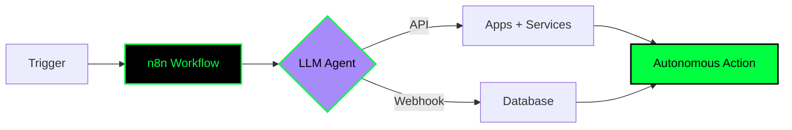

<div align="center">


<br/>


<br/>
<a href="https://portfolio-v2-chi-lilac.vercel.app/"></a>

</div>

---

### >_ navigation.exe
```bash
israa@kali:~$ ls -la ./sections
drwxr-xr-x  ./01-system_boot
drwxr-xr-x  ./02-installed_modules
drwxr-xr-x  ./03-ctf_exploits
drwxr-xr-x  ./04-ai_neural_lab
drwxr-xr-x  ./05-deployments
drwxr-xr-x  ./06-system_diagnostics
drwxr-xr-x  ./07-secure_channel
```

---

### 🟢 >_ ./system_boot --mode ai_agent
<table>
<tr>
<td width="55%">

```bash
israa@kali:~$ whoami --fetch-profile
{
  "name": "Israa Chiheb",
  "age": 19,
  "location": "Guelma / Bejaia, Algeria",
  "education": "Higher School of Computer Science (ESI Bejaia)",
  "role": ["Frontend Developer", "CTF Player"],
  "currently_learning": [
    "Node.js & backend",
    "n8n AI automations",
    "cybersecurity deeper"
  ],
  "passion": ["swimming", "gaming", "sports photography"],
  "goal": "Full-stack dev who breaks things ethically"
}
```

</td>
<td width="45%" align="center">

<br/>

</td>
</tr>
</table>

> ```
> [OK] frontend_interface loaded
> [OK] kali_linux environment detected
> [OK] curiosity driver v19.0 installed
> [..] backend_skills compiling...
> ```

---

### ⚡ >_ tail -f ./current_processes.log
```bash
[+] [PID 1337] Building frontend interfaces — HTML, CSS, JS, Tailwind & React
[+] [PID 1338] Learning Node.js & Express — working my way toward full-stack
[+] [PID 1339] Playing CTF challenges — web exploitation, reverse engineering, forensics
[+] [PID 1340] Exploring cybersecurity with Kali Linux
[+] [PID 1341] Creating AI automations with n8n — apps, APIs & LLMs into smart workflows
[+] [PID 1342] Occasionally shooting sports photography
```

---

### 🛠️ >_ apt install ./stack --all-modules
<div align="center">

```bash
israa@kali:~$ neofetch --tech-stack
```
[](https://skillicons.dev)
<br/>


</div>

---

### 🚩 >_ root@ctf:~/exploits ./run_attack.sh
> I break things on purpose — it's called learning.
```bash
root@ctf:~# cat ./ctf_profile.txt
[*] WEB EXPLOITATION — SQLi, XSS, IDOR, and more
[*] FORENSICS & OSINT — finding what's hidden
[*] REVERSE ENGINEERING — understanding how things work under the hood
[*] PLATFORMS — TryHackMe | Hack The Box | PicoCTF
```
<div align="center">


<br/>

</div>

---

### 🤖 >_ python3 ./ai_neural_lab.py --activate
> If it can be automated, I'll automate it.
```python
class AIAgent(israa.Brain):
    def __init__(self):
        self.engine = "n8n + LLMs"
        self.workflows = ["triggers", "webhooks", "multi-step flows"]
        self.capabilities = [
            "Connecting apps, APIs, and AI models into smooth workflows",
            "Wiring up LLMs to build agents that take real action",
            "Designing end-to-end automations — no unnecessary manual steps",
            "Experimenting with triggers, webhooks, and multi-step flows"
        ]
    def run(self):
        while True:
            automate(everything=True)
```
<div align="center">




</div>

---

### 📂 >_ ./deployments --featured
<div align="center">
<a href="https://portfolio-v2-chi-lilac.vercel.app/"></a>

```bash
israa@kali:~/projects$ git log --oneline --featured
* portfolio-v2 -> React + Tailwind [LIVE]
* next-project -> cooking... [IN PROGRESS]
* ai-automation-flows -> n8n agents [COMING SOON]
```
> More projects cooking — dropping soon! Check the portfolio above for the latest.
</div>

---

### 📊 >_ htop ./system_diagnostics
<div align="center">

<br/>


<br/>

<br/>

</div>

```bash
israa@kali:~$ uptime --stats
 CPU: ██████████░░ 82% coding
 MEM: ████████░░░░ 68% CTF grinding
 NET: ████████████ 100% curiosity
```

---

### 📡 >_ ./open_secure_channel --connect
<div align="center">

```bash
israa@kali:~$ ssh connect@israa -p 22
[*] encrypted channel established...
```
<a href="https://portfolio-v2-chi-lilac.vercel.app/"></a>
<a href="https://github.com/itsmeisraa"></a>
<a href="mailto:israaisraa202000@gmail.com"></a>
<a href="https://discordapp.com/users/748619400034385991"></a>
<br/>


`root@israa:~# logout` — `session saved. see you on the other side`
<br/>
<i>"First, solve the problem. Then, write the code."</i>
</div>
