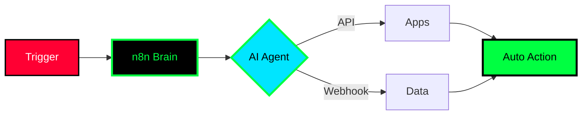

<div align="center">


<br/>


<br/>
<a href="https://portfolio-v2-chi-lilac.vercel.app/"></a>

<br/><br/>


</div>

### >_ navigation.exe
```bash
israa@kali:~$ ls ./modules
./01-boot  ./02-stack  ./03-ctf  ./04-ai_lab  ./05-builds  ./06-stats  ./07-contact
```

<div align="center">

</div>

###  >_ ./boot_israa.sh
<table>
<tr>
<td width="55%">

```bash
israa@kali:~$ whoami
{
  "name": "Israa Chiheb",
  "age": 19,
  "location": "Guelma / Bejaia, Algeria",
  "school": "Higher School of Computer Science (ESI Bejaia)",
  "role": ["Frontend Developer", "CTF Player"],
  "learning": ["Node.js & backend", "n8n AI automations", "cybersecurity"],
  "love": ["swimming", "gaming", "sports photography"],
  "goal": "Full-stack dev who breaks things ethically"
}
```
</td>
<td width="45%" align="center">


</td>
</tr>
</table>

<details open>
<summary><b>⚡ live_processes — click to expand / collapse</b></summary>

```bash
[+] 🎨 Building frontend — HTML, CSS, JS, Tailwind & React
[+] 🔧 Learning Node.js & Express — becoming full-stack
[+] 🚩 Playing CTFs — web exploitation, reverse, forensics
[+] 🔐 Hacking with Kali Linux
[+] 🤖 Building AI automations with n8n — APIs + LLMs + workflows
[+] 📸 Shooting sports photography
[+] 🔥 status: compiling_future.exe [████████--] 80%
```
</details>

<div align="center">

</div>

### 🛠️ >_ ./load_stack --auto
<div align="center">

<br/>

[](https://skillicons.dev)
<br/>


<br/>

</div>

<div align="center">

</div>

### 🚩 >_ ./ctf_attack --live
> I break things on purpose — it's called learning.
```bash
root@ctf:~# cat exploits.txt
[+] WEB → SQLi | XSS | IDOR
[+] FORENSICS + OSINT → find the hidden
[+] REVERSE → how it works under the hood
[+] ARENAS → TryHackMe | HackTheBox | PicoCTF
```

<div align="center">


<br/><br/>

<br/>

</div>

<div align="center">

</div>

### 🤖 >_ ./ai_lab --neural_online
> If it can be automated, I'll automate it.
```python
class AIAgent(israa.brain):
    engine = "n8n + LLMs + APIs"
    workflows = ["triggers", "webhooks", "multi-step agents"]
    powers = [
      "connect apps + APIs + AI into one flow",
      "LLM agents that take REAL action",
      "zero manual steps, full automation",
      "experiment daily with new nodes"
    ]
    def run(self):
        while alive: automate(everything=True)
```

<div align="center">




<br/>

</div>

<div align="center">

</div>

### 📂 >_ ./builds --featured
<div align="center">
<a href="https://portfolio-v2-chi-lilac.vercel.app/"></a>

```bash
israa@kali:~/projects$ git log --oneline
* portfolio-v2 → LIVE — React + Tailwind
* next-build → cooking...
* ai-flows → n8n agents coming soon
```
> More projects cooking — dropping soon! Check portfolio for latest.
<br/>

</div>

<div align="center">

</div>

### 📊 >_ ./stats --live_diagnostics
<div align="center">

<br/>


<br/>

<br/>

<br/>

</div>

```bash
CPU: [██████████--] 82% coding
MEM: [████████----] 68% CTF
NET: [████████████] 100% curiosity
```

<div align="center">

</div>

### 📡 >_ ./contact --secure_channel
<div align="center">

```bash
israa@kali:~$ ssh connect@israa
[+] encrypted channel established...
```
<a href="https://portfolio-v2-chi-lilac.vercel.app/"></a>
<a href="https://github.com/itsmeisraa"></a>
<a href="mailto:israaisraa202000@gmail.com"></a>
<a href="https://discordapp.com/users/748619400034385991"></a>
<br/><br/>

<br/>

<code>root@israa:~# logout — session saved</code>
</div>
